<!-- Custom SVG portfolio. Rebuilt daily using real GitHub data. Keep adjacent third-width images on a single line. -->

 
 
 
 
<picture><source media="(prefers-color-scheme: dark)" srcset="./cards/title-coding-dark.svg" /></picture> 

<a href="https://yusufaliaskin.com">portfolio</a> &nbsp;/&nbsp; <a href="https://www.linkedin.com/in/yusufaliaskin/">linkedin</a> &nbsp;/&nbsp; <a href="https://github.com/yusufaliaskin?tab=repositories">projects</a> &nbsp;/&nbsp; <a href="mailto:yusufaliaskin@gmail.com">contact</a>

Softwareentwicklung · KI · Cybersicherheit · Automatisierung

<a href="README.md">English</a> &nbsp;·&nbsp; <a href="README_TR.md">Türkçe</a> &nbsp;·&nbsp; <a href="README_DE.md">Deutsch</a> &nbsp;·&nbsp; <a href="README_RU.md">Русский</a> &nbsp;·&nbsp; <a href="README_ZH.md">中文</a>

