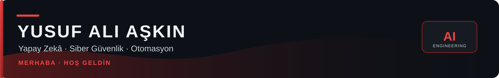
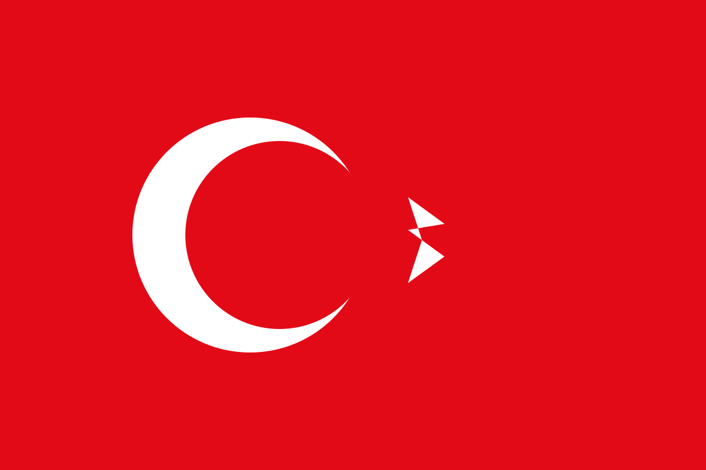
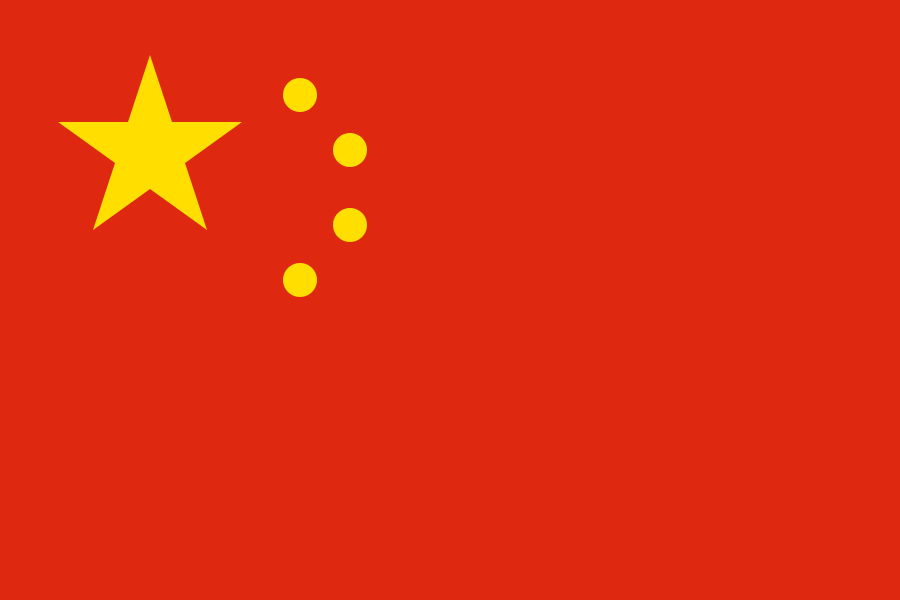
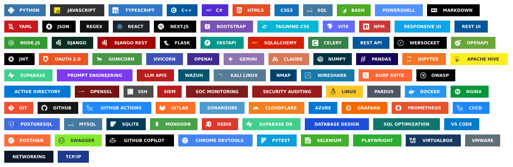
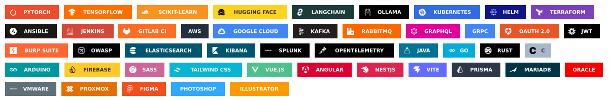
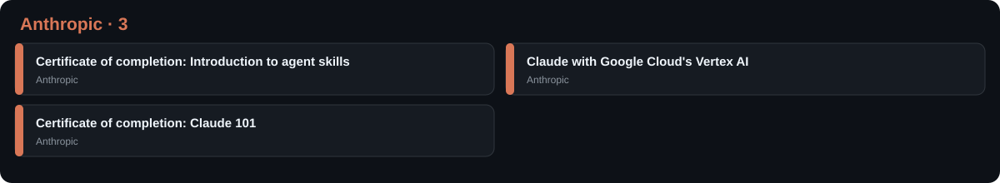
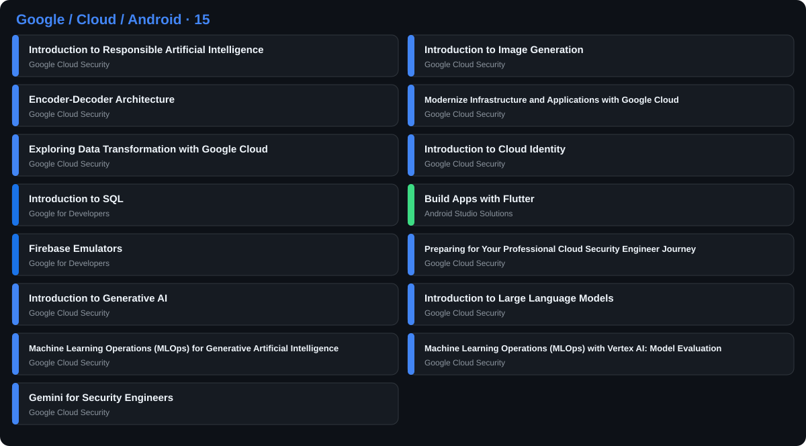
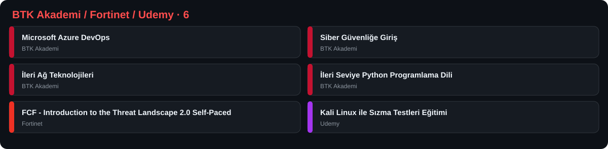
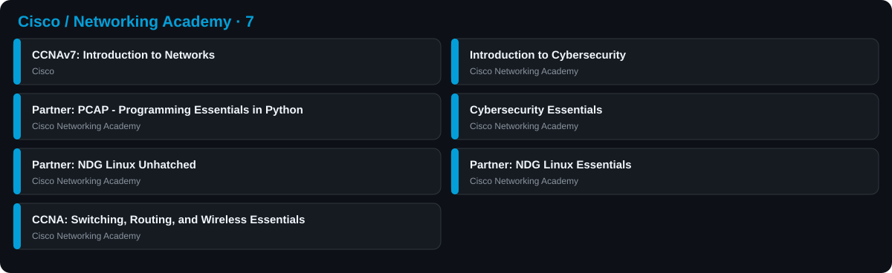

  <a href="README.md"> English</a> ·
  <a href="README_TR.md"> Türkçe</a> ·
  <a href="README_DE.md"> Deutsch</a> ·
  <a href="README_RU.md"> Русский</a> ·
  <a href="README_ZH.md"> 中文</a>

<h2 align="center">👨‍💻 Hakkımda</h2>

  Yapay zekâ, siber güvenlik, otomasyon ve modern yazılım sistemlerine odaklanan bir yazılım mühendisiyim. Backend mühendisliği, altyapı, izleme ve akıllı uygulamalar alanlarında pratik araçlar geliştirmeyi seviyorum. Sürekli öğrenmeye, otomasyona ve sistemleri iyileştirmeye odaklanıyorum.

  
  
  
  
  

  
  

  <picture>
    <source media="(prefers-color-scheme: dark)" srcset="https://raw.githubusercontent.com/yusufaliaskin/yusufaliaskin/output/github-contribution-grid-snake-dark.svg" />
    <source media="(prefers-color-scheme: light)" srcset="https://raw.githubusercontent.com/yusufaliaskin/yusufaliaskin/output/github-contribution-grid-snake.svg" />
    
  </picture>

---

  
<strong>🧰 Ana Teknoloji Yığını</strong>

   
  

  
<strong>🧠 Ek Bilgiler ve Sürekli Öğrenme</strong>

   
  

  
<strong>🎓 Sertifikalar · 31</strong>

   
  

    
    
    
    
  

  

    <a href="https://www.linkedin.com/in/yusufaliaskin/details/certifications/"><strong>LinkedIn'deki Tüm Sertifikaları Görüntüle →</strong></a>
  

  
<strong>🏗️ Mimari ve Mühendislik</strong>

   
  
<strong>Yazılım Tasarımı ve Mimari</strong>

  

    
    
    
    
    
    
  

  
<strong>Geliştirme ve Teslimat</strong>

  

    
    
    
    
    
  

  
<strong>Güvenlik ve Gözlemlenebilirlik</strong>

  

    
    
    
  

  
<strong>🚀 Öne Çıkan Projeler</strong>

   
  <table>
    <tr>
      <td width="50%" valign="top">
        <h3><a href="https://github.com/yusufaliaskin/ZKSessions">ZKSessions</a></h3>
        
Windows ve Wazuh olaylarını ilişkilendirerek güvenlik operasyonlarının izlenmesini sağlayan Django tabanlı bir oturum istihbaratı platformu.

        

          
          
          
        

        <a href="https://github.com/yusufaliaskin/ZKSessions">Depoyu İncele →</a>
      </td>
      <td width="50%" valign="top">
        <h3><a href="https://github.com/yusufaliaskin/AIStudio">AIStudio</a></h3>
        
Çok modlu iş akışları ve derin araştırma araçları içeren, Gemini, OpenAI ve Claude için birleşik Flask arayüzü.

        

          
          
          
        

        <a href="https://github.com/yusufaliaskin/AIStudio">Depoyu İncele →</a>
      </td>
    </tr>
    <tr>
      <td width="50%" valign="top">
        <h3><a href="https://github.com/yusufaliaskin/F.R.I.D.A.Y-AI">F.R.I.D.A.Y-AI</a></h3>
        
Özel çalışma zamanı verilerini herkese açık depodan ayrı tutan, Python ile geliştirilmiş yerel Windows AI asistanı.

        

          
          
          
        

        <a href="https://github.com/yusufaliaskin/F.R.I.D.A.Y-AI">Depoyu İncele →</a>
      </td>
      <td width="50%" valign="top">
        <h3><a href="https://github.com/yusufaliaskin/afetnet.com">AfetNet</a></h3>
        
Gerçek zamanlı deprem bilgileri, aile takibi ve kriz bildirimleri sunan React Native acil iletişim uygulaması.

        

          
          
          
        

        <a href="https://github.com/yusufaliaskin/afetnet.com">Depoyu İncele →</a>
      </td>
    </tr>
  </table>

  
<strong>📊 GitHub İstatistikleri</strong>

   
  

    
  

  

    
  

  

