<!-- Custom SVG portfolio. Rebuilt daily using real GitHub data. Keep adjacent third-width images on a single line. -->

 
 
 
 
<picture><source media="(prefers-color-scheme: dark)" srcset="./cards/title-coding-dark.svg" /></picture> 

 
 
 
 
 

