<!-- Animated personal portfolio. Three featured projects; links and language options below. -->

<a href="https://yusufaliaskin.com"><picture><source media="(max-width: 600px)" srcset="./cards/hero-mobile.svg" /></picture></a> 
<picture><source media="(max-width: 600px)" srcset="./cards/heatmap-mobile.svg" /></picture> 
<picture><source media="(max-width: 600px)" srcset="./cards/activity-mobile.svg" /></picture> 
<a href="https://github.com/yusufaliaskin?tab=repositories"><picture><source media="(max-width: 600px)" srcset="./cards/build-mobile.svg" /></picture></a><a href="https://github.com/yusufaliaskin?tab=repositories"><picture><source media="(max-width: 600px)" srcset="./cards/secure-mobile.svg" /></picture></a><a href="https://www.linkedin.com/in/yusufaliaskin/details/certifications/"><picture><source media="(max-width: 600px)" srcset="./cards/learn-mobile.svg" /></picture></a> 
<picture><source media="(max-width: 600px) and (prefers-color-scheme: dark)" srcset="./cards/title-coding-dark-mobile.svg" /><source media="(max-width: 600px)" srcset="./cards/title-coding-light-mobile.svg" /><source media="(prefers-color-scheme: dark)" srcset="./cards/title-coding-dark.svg" /></picture> 
<a href="https://github.com/yusufaliaskin/AIStudio"><picture><source media="(max-width: 600px)" srcset="./cards/repo-AIStudio-mobile.svg" /></picture></a><a href="https://github.com/yusufaliaskin/F.R.I.D.A.Y-AI"><picture><source media="(max-width: 600px)" srcset="./cards/repo-F.R.I.D.A.Y-AI-mobile.svg" /></picture></a><a href="https://github.com/yusufaliaskin/afetnet.com"><picture><source media="(max-width: 600px)" srcset="./cards/repo-afetnet.com-mobile.svg" /></picture></a>

<a href="https://yusufaliaskin.com"><picture><source media="(max-width: 600px)" srcset="./cards/footer-nav-portfolio-mobile.svg" /></picture></a><a href="https://www.linkedin.com/in/yusufaliaskin/"><picture><source media="(max-width: 600px)" srcset="./cards/footer-nav-linkedin-mobile.svg" /></picture></a><a href="https://github.com/yusufaliaskin?tab=repositories"><picture><source media="(max-width: 600px)" srcset="./cards/footer-nav-projects-mobile.svg" /></picture></a><a href="mailto:yusufaliaskin@gmail.com"><picture><source media="(max-width: 600px)" srcset="./cards/footer-nav-contact-mobile.svg" /></picture></a> 
<a href="README.md"><picture><source media="(max-width: 600px)" srcset="./cards/footer-language-en-mobile.svg" /></picture></a><a href="README_TR.md"><picture><source media="(max-width: 600px)" srcset="./cards/footer-language-tr-mobile.svg" /></picture></a><a href="README_DE.md"><picture><source media="(max-width: 600px)" srcset="./cards/footer-language-de-mobile.svg" /></picture></a><a href="README_RU.md"><picture><source media="(max-width: 600px)" srcset="./cards/footer-language-ru-mobile.svg" /></picture></a><a href="README_ZH.md"><picture><source media="(max-width: 600px)" srcset="./cards/footer-language-zh-mobile.svg" /></picture></a>

