<!-- Yusuf Ali Aşkın · animated SVG portfolio · 23 verified GitHub repositories · responsive images. -->

<a href="https://yusufaliaskin.com"><picture><source media="(max-width: 600px)" srcset="./cards/hero-mobile.svg" /></picture></a> 
<picture><source media="(max-width: 600px)" srcset="./cards/heatmap-mobile.svg" /></picture> 
<picture><source media="(max-width: 600px)" srcset="./cards/activity-mobile.svg" /></picture> 
<a href="https://github.com/yusufaliaskin?tab=repositories"><picture><source media="(max-width: 600px)" srcset="./cards/build-mobile.svg" /></picture></a><a href="https://github.com/yusufaliaskin?tab=repositories"><picture><source media="(max-width: 600px)" srcset="./cards/secure-mobile.svg" /></picture></a><a href="https://www.linkedin.com/in/yusufaliaskin/details/certifications/"><picture><source media="(max-width: 600px)" srcset="./cards/learn-mobile.svg" /></picture></a> 
<picture><source media="(max-width: 600px)" srcset="./cards/repositories-title-mobile.svg" /></picture> 
<picture><source media="(max-width: 600px)" srcset="./cards/repositories-public-mobile.svg" /></picture> 
<a href="https://github.com/yusufaliaskin/yusufaliaskin"><picture><source media="(max-width: 600px)" srcset="./cards/project-yusufaliaskin-mobile.svg" /></picture></a> 
<a href="https://github.com/yusufaliaskin/BMAPP"><picture><source media="(max-width: 600px)" srcset="./cards/project-BMAPP-mobile.svg" /></picture></a> 
<a href="https://github.com/yusufaliaskin/yusufaliaskin.com"><picture><source media="(max-width: 600px)" srcset="./cards/project-yusufaliaskin.com-mobile.svg" /></picture></a> 
<a href="https://github.com/yusufaliaskin/F.R.I.D.A.Y-AI"><picture><source media="(max-width: 600px)" srcset="./cards/project-F.R.I.D.A.Y-AI-mobile.svg" /></picture></a> 
<a href="https://github.com/yusufaliaskin/afetnet.com"><picture><source media="(max-width: 600px)" srcset="./cards/project-afetnet.com-mobile.svg" /></picture></a> 
<a href="https://github.com/yusufaliaskin/AI-System-Dashboard"><picture><source media="(max-width: 600px)" srcset="./cards/project-AI-System-Dashboard-mobile.svg" /></picture></a> 
<a href="https://github.com/yusufaliaskin/bostanoglu.com.tr"><picture><source media="(max-width: 600px)" srcset="./cards/project-bostanoglu.com.tr-mobile.svg" /></picture></a> 
<a href="https://github.com/yusufaliaskin/yusufaliaskin.com.tr"><picture><source media="(max-width: 600px)" srcset="./cards/project-yusufaliaskin.com.tr-mobile.svg" /></picture></a> 
<a href="https://github.com/yusufaliaskin/AIStudio"><picture><source media="(max-width: 600px)" srcset="./cards/project-AIStudio-mobile.svg" /></picture></a> 
<a href="https://github.com/yusufaliaskin/IT-Toolbox-Global"><picture><source media="(max-width: 600px)" srcset="./cards/project-IT-Toolbox-Global-mobile.svg" /></picture></a> 
<a href="https://github.com/yusufaliaskin/Swopy-Troi"><picture><source media="(max-width: 600px)" srcset="./cards/project-Swopy-Troi-mobile.svg" /></picture></a> 
<a href="https://github.com/yusufaliaskin/Swopy-Network"><picture><source media="(max-width: 600px)" srcset="./cards/project-Swopy-Network-mobile.svg" /></picture></a> 
<picture><source media="(max-width: 600px)" srcset="./cards/repositories-private-mobile.svg" /></picture> 
<picture><source media="(max-width: 600px)" srcset="./cards/project-SSL-VPN-TURKEY-mobile.svg" /></picture> 
<picture><source media="(max-width: 600px)" srcset="./cards/project-Guacview-Search-mobile.svg" /></picture> 
<picture><source media="(max-width: 600px)" srcset="./cards/project-AtlasAI-mobile.svg" /></picture> 
<picture><source media="(max-width: 600px)" srcset="./cards/project-BenimHavuzum-mobile.svg" /></picture> 
<picture><source media="(max-width: 600px)" srcset="./cards/project-A.R.K-Desktop-APP-mobile.svg" /></picture> 
<picture><source media="(max-width: 600px)" srcset="./cards/project-ZKBGFILEZILLA-mobile.svg" /></picture> 
<picture><source media="(max-width: 600px)" srcset="./cards/project-Sessions-mobile.svg" /></picture> 
<picture><source media="(max-width: 600px)" srcset="./cards/project-CS2-SCRIPT-mobile.svg" /></picture> 
<picture><source media="(max-width: 600px)" srcset="./cards/project-joseph-code-and-bot-mobile.svg" /></picture> 
<picture><source media="(max-width: 600px)" srcset="./cards/project-BEUN-CAMPUS-mobile.svg" /></picture> 
<picture><source media="(max-width: 600px)" srcset="./cards/project-jose-h-dev-muzik-mobile.svg" /></picture> 

<picture><source media="(max-width: 600px)" srcset="./cards/footer-heading-mobile.svg" /></picture> 
<a href="https://yusufaliaskin.com"><picture><source media="(max-width: 600px)" srcset="./cards/footer-nav-portfolio-mobile.svg" /></picture></a><a href="https://www.linkedin.com/in/yusufaliaskin/"><picture><source media="(max-width: 600px)" srcset="./cards/footer-nav-linkedin-mobile.svg" /></picture></a><a href="https://github.com/yusufaliaskin?tab=repositories"><picture><source media="(max-width: 600px)" srcset="./cards/footer-nav-projects-mobile.svg" /></picture></a><a href="mailto:yusufaliaskin@gmail.com"><picture><source media="(max-width: 600px)" srcset="./cards/footer-nav-contact-mobile.svg" /></picture></a> 
<picture><source media="(max-width: 600px)" srcset="./cards/footer-languages-mobile.svg" /></picture> 
<a href="README.md"><picture><source media="(max-width: 600px)" srcset="./cards/footer-language-en-mobile.svg" /></picture></a><a href="README_TR.md"><picture><source media="(max-width: 600px)" srcset="./cards/footer-language-tr-mobile.svg" /></picture></a><a href="README_DE.md"><picture><source media="(max-width: 600px)" srcset="./cards/footer-language-de-mobile.svg" /></picture></a><a href="README_RU.md"><picture><source media="(max-width: 600px)" srcset="./cards/footer-language-ru-mobile.svg" /></picture></a><a href="README_ZH.md"><picture><source media="(max-width: 600px)" srcset="./cards/footer-language-zh-mobile.svg" /></picture></a>

